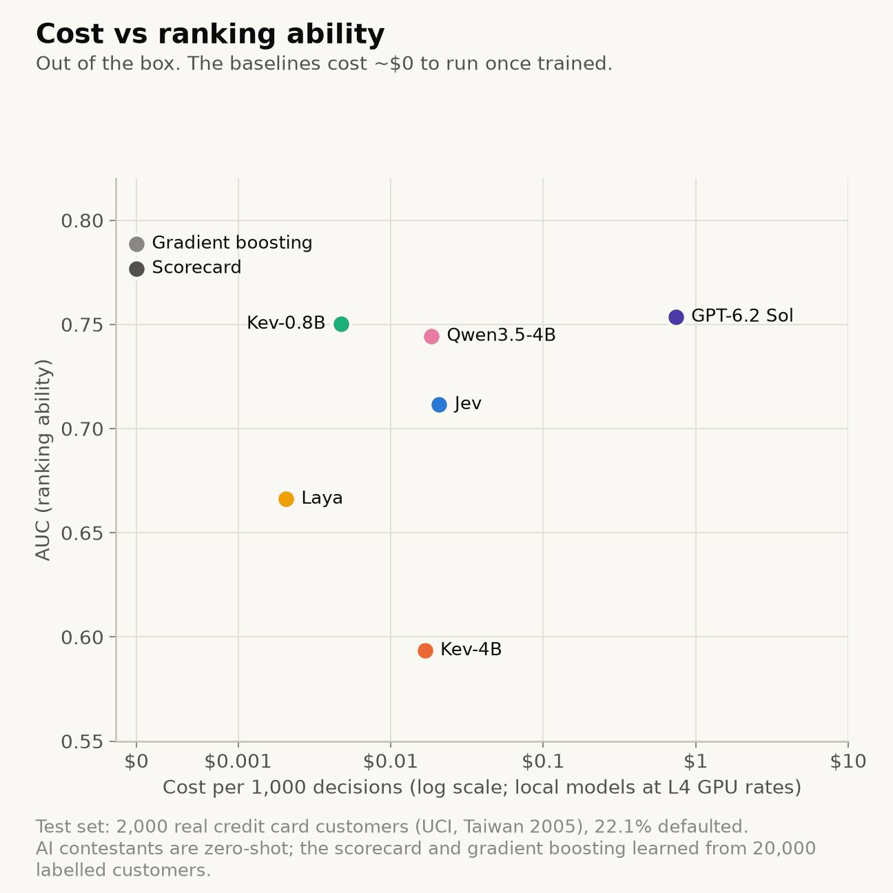

*The method, the statistics behind each finding, and every check I ran on my own results.*

This is the companion to [the main post](/2026/11/23/can-ai-know-when-its-wrong/), where I gave Jev and 7 other models 2,000 real credit-card customers and checked whether their percentages came true. That post has the story and the headline results. This one has everything behind them, for readers who want to check my working. The code, every prediction and every check are on [GitHub](https://github.com/nishzsche/can-ai-know-when-its-wrong).

## How the experiment was set up

**Data**
- **Source:** [UCI "Default of Credit Card Clients"](https://archive.ics.uci.edu/dataset/350/default+of+credit+card+clients): Yeh, I. C., & Lien, C. H. (2009), *Expert Systems with Applications* 36(2), 2473–2480, [doi:10.1016/j.eswa.2007.12.020](https://doi.org/10.1016/j.eswa.2007.12.020). Licence: CC BY 4.0.
- **Splits:** 30,000 customers, split with a fixed seed and stratified on the outcome. Train (20,000) teaches the two classic models. Tune (2,000) is used only to recalibrate the AI models. Test (2,000) scores every model, and nothing is ever adjusted using it. A reserve of 6,000 is never used. The default rate is 22.1% in each.
- **Inputs:** 19 fields: the credit limit, and six months each of bill amount, amount paid and repayment status. Sex, marital status, age and education are dropped before any rendering or training.

**What the AI models saw**
- **One template, unit-tested and versioned (v2),** renders every customer for every AI model, as in the example in the main post.
- **Repayment codes are shown raw,** with only their documented meaning. The common interpretation of the undocumented codes (−2 as "no balance", 0 as "paid the minimum") is contradicted by the data, so I didn't give the models an interpretation the trained models don't get.
- **Each row pairs a month's bill with that month's payment,** as the data file does. Payments usually settle the *previous* month's bill, which turned out to matter for one model (see the layout check below).

**Three conditions for each AI model**
1. **Out of the box.**
2. **Told the base rate:** one sentence before the question, "In this portfolio, about 22.1% of customers miss next month's payment." That's exactly the test customers' rate, so it's the best case. A bank's own estimate would be rougher.
3. **Recalibrated:** [Platt scaling](https://en.wikipedia.org/wiki/Platt_scaling) or [isotonic regression](https://en.wikipedia.org/wiki/Isotonic_regression), chosen per model by 5-fold [cross-validation](https://en.wikipedia.org/wiki/Cross-validation_%28statistics%29) on tune, fitted on all of tune and applied unchanged to test.

**Contestants and versions**

| Contestant | Version and setup |
|---|---|
| Jev | `typesafe/jev-1.14-20261014` via [OpenRouter](https://openrouter.ai)'s System One endpoint |
| Kev-4B, Kev-0.8B | [`jaredpalmer/kev`](https://github.com/jaredpalmer/kev) v1.0, served on an NVIDIA L4 |
| Laya | `convaiinnovations/laya` at revision `fd4f9dbc`, on the L4 |
| Qwen3.5-4B | `Qwen/Qwen3.5-4B` at `851bf6e8`, served by [vLLM](https://github.com/vllm-project/vllm) with thinking off. P(yes) comes from the first answer token's top-20 [logprobs](https://cookbook.openai.com/examples/using_logprobs), with every spelling of each option combined |
| GPT-6.2 Sol | `openai/gpt-6.2-sol` via OpenRouter: reasoning effort medium (it used no reasoning tokens on 90% of answers), seed 0, strict JSON answer |
| Scorecard | [Weight-of-evidence binning](https://en.wikipedia.org/wiki/Credit_scorecards) plus logistic regression, all 19 fields, trained on the 20,000 train customers |
| Gradient boosting | [LightGBM](https://github.com/microsoft/LightGBM), 157 rounds, trained on the same 20,000 |

## How I measured honesty and ranking

- **Calibration:** expected calibration error ([ECE](https://arxiv.org/abs/1706.04599)) with 10 equal-width bins is the headline. I also report ECE with 10 equal-mass bins (deciles), the [Brier score](https://en.wikipedia.org/wiki/Brier_score), [calibration-in-the-large and calibration slope](https://doi.org/10.1186/s12916-019-1466-7), and a [Hosmer–Lemeshow test](https://en.wikipedia.org/wiki/Hosmer%E2%80%93Lemeshow_test) by decile.
- **The noise floor:** even a perfectly calibrated model scores some ECE on 2,000 customers. I simulated outcomes from each model's own probabilities: the median ECE is 1.2 to 2.2 points and the 95th percentile 2.3 to 3.3. So gaps under about 2 points are noise. The honesty arc chart shades this band.
- **Ranking:** [AUC](https://en.wikipedia.org/wiki/Receiver_operating_characteristic#Area_under_the_curve) and [KS](https://en.wikipedia.org/wiki/Kolmogorov%E2%80%93Smirnov_test), with [bootstrap](https://en.wikipedia.org/wiki/Bootstrapping_%28statistics%29) 95% intervals (1,000 resamples). Against the scorecard, paired bootstrap differences on the same customers (2,000 resamples), with a [Holm correction](https://en.wikipedia.org/wiki/Holm%E2%80%93Bonferroni_method) over the twelve AI comparisons.
- **In lending terms:** the default rate among the 80% of customers each model rates safest.
- **Records:** every prediction is saved with its probability, model version, condition, latency and cost. The extra statistics are in `analysis/robustness.py`.

## The findings in detail

### Most AI models overstate the risk

Five of the six overstated it: Jev averaged 48% and Kev-4B 49%, against 22% actual. Laya was the exception, slightly under.
- **Jev's error is mostly a constant shift.** Its calibration slope is 0.97, where 1 is ideal: it ranks customers sensibly, but every number starts too high.
- **Kev-4B's numbers barely separate customers.** Its promises range from 24% to 67% across the ten groups, but what actually happened only ranges from 14% to 30%.

### The base-rate sentence versus shifting the numbers

Points off (ECE × 100) on the test customers:

| Model | Out of the box | Told the base rate | Shifted to average 22.1% | Recalibrated |
|---|---:|---:|---:|---:|
| Jev | 26.5 | 15.5 | 6.8 | 1.9 |
| Kev-4B | 26.7 | 3.4 | 1.8 | 0.3 |
| Kev-0.8B | 9.0 | 26.9 | 4.5 | 2.3 |
| Laya | 5.2 | 4.0 | 4.0 | 4.1 |
| Qwen3.5-4B | 14.0 | 7.4 | 5.7 | 3.9 |
| GPT-6.2 Sol | 5.2 | 3.2 | 3.4 | 1.7 |

- **The sentence clearly helped three** (Kev-4B, Jev, Sol), helped Qwen's numbers but cost it ranking (AUC 0.744 to 0.710), made no clear difference to Laya, and broke Kev-0.8B.
- **Kev-4B also ranked much better with the sentence** (AUC 0.594 to 0.757): it changed *which* customers it flagged. It turns out to be unusually sensitive to how its input is presented, as the layout check shows.
- **Kev-0.8B treats the sentence as a warning sign,** not a statistic: told that about 22% miss a payment, it raised its average from 31% to 49%.
- **The shift** adds one constant to each model's [log-odds](https://en.wikipedia.org/wiki/Logit) so the average prediction equals the train default rate (22.1%). It needs no outcome for any customer and leaves ranking unchanged. It beat the sentence for Jev, Kev-4B, Kev-0.8B and Qwen, and roughly tied for Laya and Sol.

### What GPT-6.2 Sol knows about this dataset

- **Memorization:** in [tabmemcheck](https://github.com/interpretml/LLM-Tabular-Memorization-Checker)'s tests (from [Bordt et al., 2024](https://arxiv.org/abs/2404.06209)), plus a longer, deterministic version with room for the model's reasoning, Sol reproduced 31 customers from the original data file verbatim, densely through customer 33. Three of them are in my test set. Without those 3, no metric for any model moves by more than 0.0006. Qwen3.5-4B showed no memorization. The decision models can't be probed this way.
- **Recognition:** asked which public dataset a summary came from, Sol named this one for 53 of 53 summaries and gave its default rate as 22.12%, the published file's exact rate. With the currency, dates and raw codes removed, it still did, 50 of 50, citing the six-month structure itself. Two limits: the question invites a dataset name, and there was no negative control (summaries from another source).
- **A false base rate:** on 500 test customers told "about 10.0%" instead of 22.1%, Sol's average fell from 0.258 to 0.175. That's a pass-through of 0.69 (95% interval 0.64–0.73) of the change in the stated rate, or about half the distance to 10%, with its ranking unchanged. Told the true rate, it barely moved, because its own estimate was already close.
- **But not the file's patterns:** out of the box, Sol rates customers whose latest status is code −2, −1 or 0 at 10%, 13% and 18%. The test customers defaulted at 15%, 14% and 12%. That's the conventional credit reading, not this file's.

So Sol knows this dataset exists and how often its customers defaulted, which researchers call [semantic contamination](https://www.arxiv.org/pdf/2510.20351). I can't show it used that knowledge rather than a sensible guess for any card portfolio, but its score here isn't a clean zero-shot result.

### Ranking: the trained models still win

- **Every AI model ranked below the scorecard** (0.777) and gradient boosting (0.789).
- **The closest six results** (Kev-4B and Sol with the base rate, Sol and Kev-0.8B out of the box, Kev-0.8B and Jev with the base rate) were 2 to 3 points behind. Each gap is significant on its own, but after the Holm correction they could still be chance (p ≈ 0.06). The rest were clearly behind (Holm p of 0.021 or less).
- **The ceiling is low.** Six months of payment history can only tell you so much. The best AI models' 0.75 is about 88% of the way from a coin flip to gradient boosting.

Approving the 80% of customers each model rates safest, the default rate among those approved (out of the box unless noted):

| Model | Default rate among approved |
|---|---:|
| Gradient boosting | 12.9% |
| GPT-6.2 Sol | 13.4% |
| Scorecard | 13.6% |
| Kev-0.8B | 13.6% |
| Jev, told the base rate | 13.6% |
| Qwen3.5-4B | 13.9% |
| Kev-4B, told the base rate | 14.1% |
| Jev | 14.2% |
| Laya | 17.7% |
| Kev-4B | 20.4% |

### Recalibration: honesty bought back with labels

| Model (recalibrated) | ECE, equal-width bins | ECE, equal-mass bins | Hosmer–Lemeshow p |
|---|---:|---:|---:|
| Jev | 0.019 | 0.033 | 0.011 |
| Kev-4B | 0.003 | 0.023 | 0.282 |
| Kev-0.8B | 0.023 | 0.027 | 0.055 |
| Laya | 0.041 | 0.034 | 0.001 |
| Qwen3.5-4B | 0.039 | 0.037 | < 0.001 |
| GPT-6.2 Sol | 0.017 | 0.019 | 0.434 |
| Scorecard (trained) | 0.014 | 0.023 | 0.228 |
| Gradient boosting (trained) | 0.017 | 0.016 | 0.597 |

- **Every AI model lands within about 2 to 4 points,** depending on the binning, against 1.4 to 2.3 for the scorecard.
- **Kev-4B's 0.003 is luck of the binning:** with equal-mass bins it's 0.023, level with the scorecard.
- **The decile test still finds Jev, Laya and Qwen off** after recalibration. Sol and both Kev models pass it.
- **A scorecard trained on the same 2,000 tune customers** reaches AUC 0.758 and ECE 0.024 on test: it ranks as well as the best AI model and is about as honest.

### Cost

- **Sol:** about 74 cents per 1,000 decisions, at around two seconds each (about a dollar with the base-rate sentence).
- **Jev, through its API:** about 2 cents per 1,000.
- **The open models, on one rented GPU:** under 2 cents per 1,000, with answers in milliseconds.
- **The scorecard and gradient boosting:** essentially free to run once trained.



## Why the results look like this

| Most recent status | Customers | Actually defaulted | Jev | Kev-4B | Laya | GPT-6.2 Sol | Scorecard |
|---|---:|---:|---:|---:|---:|---:|---:|
| Paid on time (code −1) | 405 | 14% | 30% | 37% | 12% | 13% | 15% |
| Not late (code 0) | 971 | 12% | 51% | 54% | 20% | 18% | 13% |
| 1 month late | 245 | 37% | 61% | 51% | 27% | 51% | 36% |
| 2 months late | 170 | 72% | 75% | 58% | 34% | 74% | 66% |

- **One group causes most of the overstatement.** Half the customers are "not late (code 0)": they carry a balance and pay part of it, on time. Only 12% defaulted. Jev predicted 51% for them and Kev-4B 54%, which accounts for about three quarters of both models' overstatement.
- **Some models start near even odds.** Kev-4B gives 80% of customers between 30% and 64%, centred near 49%, and Jev averages 48%. My best explanation is that decision models learn from tasks where "yes" isn't rare, so with no base rate they start close to 50/50. [Kev's published training data](https://github.com/jaredpalmer/kev) fits this: general text-classification sets, and nothing like this data. Jev's training data isn't published.
- **It isn't the world's default experience.** In the US, [credit-card delinquency](https://fred.stlouisfed.org/series/DRCCLACBS) peaked at 6.8% in the 2009 financial crisis, fell below 2% during COVID, and is about 2.9% now. (That's a different measure, the share of balances 30 or more days late, so it's only a rough guide.) A model leaning on recent world events would have *understated* the risk here, not doubled it.
- **Honest on average isn't the same as useful.** Laya's percentages vary from customer to customer, but not much with lateness: two months late gets 34%, when 72% defaulted.
- **Sol tracks reality for late payers** (51% for one month late, 37% actual; 74% for two months, 72% actual) but gets the three not-late groups in the wrong order.
- **The scorecard learned what the AI models had to guess:** customers paying part of their balance on time are about as safe as those who pay in full.

## Could the presentation have fooled me?

Two checks re-asked every AI model the same questions with the summary changed, out of the box. Neither replaces the headline results, which use the template fixed before the runs.

### Hiding the time and place

Every summary shows 2005 dates and Taiwan dollars, so a model could tell when and where these customers were: Taiwan, in the run-up to the card-debt crisis that [the dataset's authors](https://doi.org/10.1016/j.eswa.2007.12.020) say peaked in 2006. If that knowledge pushed the numbers up, hiding it should bring them down. I removed the currency symbol, numbered the months instead of dating them, and replaced the raw codes with neutral labels, then re-asked all 2,000 test customers. A 200-customer control on the original summaries measured run-to-run noise: 0.3 points or less on the average.

| Model | Average: original → disguised | Calibration error | Ranking (AUC) |
|---|---|---|---|
| Jev | 48.1% → 52.2% | 0.265 → 0.308 | 0.712 → 0.706 |
| Qwen3.5-4B | 35.5% → 38.9% | 0.140 → 0.171 | 0.744 → 0.738 |
| Kev-4B | 48.6% → 50.2% | 0.267 → 0.283 | 0.594 → 0.651 |
| GPT-6.2 Sol | 26.0% → 26.8% | 0.052 → 0.062 | 0.754 → 0.744 |
| Kev-0.8B | 30.5% → 29.2% | 0.090 → 0.084 | 0.750 → 0.747 |
| Laya | 20.4% → 15.6% | 0.052 → 0.081 | 0.666 → 0.625 |

Four of six went *up*, and the two that fell disagree in size. There's no sign that the era raised anyone's risk. The models are sensitive to wording, by 1 to 5 points. (Sol is also noisy per customer: its answers moved 2.5 points on average between two identical runs.)

### The table layout

Each row of the summary pairs a month's bill with that month's payment, but a payment usually settles the previous month's bill: in the data, a month's payment matches the previous bill 21,213 times and the same month's bill only 3,720 times. The trained models learn the real relationship from data; an AI model reading the table might not. I noted this as a data quirk before the runs but didn't flag it as a possible tilt, which it is. So I re-asked every AI model with each bill shown beside the payment made the following month. Every number is unchanged.

| Model (test) | Average: original → realigned | Calibration error | Ranking (AUC) |
|---|---|---|---|
| Kev-4B | 48.6% → 35.6% | 0.267 → 0.135 | 0.594 → 0.720 |
| Laya | 20.4% → 26.4% | 0.052 → 0.060 | 0.666 → 0.569 |
| Jev | 48.1% → 48.3% | 0.265 → 0.267 | 0.712 → 0.692 |
| Qwen3.5-4B | 35.5% → 35.2% | 0.140 → 0.144 | 0.744 → 0.715 |
| Kev-0.8B | 30.5% → 30.3% | 0.090 → 0.098 | 0.750 → 0.743 |
| GPT-6.2 Sol | 26.0% → 25.2% | 0.052 → 0.052 | 0.754 → 0.745 |

The original layout hurt Kev-4B badly: realigned, its calibration error halves and its ranking jumps, and its estimate for code 0 customers falls from 54% to 36%. It suited the other four slightly, and Laya did clearly worse realigned. The tune customers give the same picture for the five models run on both.

## What would change with different data

**The portfolio's default rate changes who looks honest, mostly through the average.** I reweighted the same customers to imitate portfolios where 5% or 50% default, keeping the same kinds of defaulters and non-defaulters in different proportions, and measured calibration error again, in points off:

| If the default rate were | 5% | 22% (actual) | 50% |
|---|---:|---:|---:|
| Jev | 41 | 26 | 11 |
| Kev-4B | 43 | 27 | 5 |
| Kev-0.8B | 23 | 9 | 15 |
| Laya | 14 | 5 | 28 |
| Qwen3.5-4B | 28 | 14 | 10 |
| GPT-6.2 Sol | 17 | 5 | 17 |
| Scorecard (trained at 22%) | 13 | 1.4 | 22 |

- **Most of this is arithmetic.** At 5%, a model's error is roughly how far its average prediction sits above 5%, so the models with high averages look worst. The reweighting also assumes defaulters and non-defaulters look the same in a safer portfolio, which real portfolios needn't follow.
- **In a high-risk book, the order flips:** at 50%, Kev-4B becomes the most honest model and Laya the least.
- **The scorecard is no exception:** it's honest at 22% because that's the rate it was trained on.
- **Ranking ability doesn't move.** AUC compares defaulters with non-defaulters, so the mix doesn't affect it.

Other things that would likely change the picture:
- **Data the models haven't seen.** On a bank's own customers, Sol can't recognise the portfolio, and I'd expect its out-of-the-box honesty to fall back towards the others'. I haven't tested this.
- **A different era.** 2005 was the run-up to Taiwan's card-debt crisis, which is why so many of these customers defaulted. The trained models would feel a change of era too, since they were tested on the same months they learned from.
- **Richer data.** Income, credit-bureau scores or a longer history would raise the ceiling for the trained models. Whether they help the AI models depends on whether a longer summary stays easy to read.

## What others have found

I'm not the first to put AI models in front of credit data, and two of my results match earlier work:
- **Trained models rank customers better.**
  - [Datta and Prahallad (2026)](https://arxiv.org/abs/2608.30086) used this same dataset, with a 2,000-customer test set too. A trained random forest ranked customers better than an LLM shown a dozen examples (AUC 0.790 vs 0.719).
  - [AlMarri et al. (2025)](https://arxiv.org/abs/2510.25701) found the same on LendingClub loans: LightGBM beat three small open LLMs.
- **LLM probabilities are unreliable.** [Kostrzewa et al. (2025)](https://arxiv.org/abs/2511.16375) asked Llama-3.3 to predict company bankruptcies. Gradient boosting won, and the LLM's probabilities bunched at a few round values such as 0.1, 0.2, 0.7 and 0.9.
- **LLMs memorize famous datasets.** [Bordt et al. (2024)](https://arxiv.org/abs/2404.06209) showed that they score better on the datasets they've memorized.
- **Decision models have been calibration-tested before,** but on general classification tasks such as BANKING77, not credit risk ([Towards AI](https://pub.towardsai.net/a-decision-model-as-a-gate-fast-well-calibrated-and-still-wrong-16-of-the-time-2ddb226b1ed5), [Towards Data Science](https://towardsdatascience.com/scikit-learn-matched-or-beat-jevs-calibration-on-banking77), [Amplitude](https://amplitude.com/blog/jev-analysis)).

**What this adds.** The credit studies measure ranking or accuracy, not whether the percentages come true. None of them tells the model the base rate, and none checks whether the model has seen the data. This experiment applies the standard banks are held to (promised vs actual, calibration error, recalibration), tests a true and a false base rate, and checks for memorization, recognition and presentation effects.

## What this test can't tell you

- **One dataset:** one bank, one country, 2005. The section above shows how much the default rate alone could change.
- **A famous dataset:** AI models have seen it in training. I tested the ones I could, but the decision models can't be probed this way.
- **No demographic fields, on purpose:** every contestant lost them equally.
- **Partly undocumented repayment codes:** so I showed the AI models the raw codes rather than guess their meaning.
- **One layout choice tilted the comparison, both ways,** as the layout check shows. The headline numbers use the layout fixed before the runs.
- **The base-rate sentence was the best case:** it stated exactly this portfolio's rate.
- **Not like for like:** the AI models answered cold while the classic models were trained. That's the real-world trade-off, but it isn't an even contest.
- **The trained models were tested at home.** They learned from customers of the same bank, in the same six months, as the test customers (a random split). Banks validate on a later period, because patterns drift. In another year or at another bank, the trained models would lose some honesty too and need retraining.
- **Models change:** these results are for the versions I tested in November 2026, all recorded.

## Smaller checks

- **Qwen option order:** swapping which letter means "yes" left its average probability almost unchanged (−0.004), and the two orders' answers correlated at 0.91, so there's no letter bias.
- **A bug in a library:** jevper, an open-source adapter used to prompt Qwen, mis-read its probabilities when the model spelled an option more than one way, turning one answer of 32% into 0.004%. I computed them myself instead and [reported the bug upstream](https://github.com/zhulinchng/jevper/issues/1).
- **Predictions before the runs:** my guesses were committed to the repository before any full run, in `PREDICTIONS.md`.

## How to reproduce

Re-scoring from the saved predictions needs no API key or GPU:

```bash
uv sync
uv run python analysis/summarize.py && uv run python analysis/figures.py
uv run python analysis/robustness.py
uv run --group runners python runners/checks/disguise.py --report
```

Rebuilding from the raw data:

```bash
uv run python data/load.py && uv run python data/splits.py
uv run python data/render.py --split test
uv run python baselines/scorecard.py && uv run python baselines/gbm.py
uv run --group runners python runners/<contestant>.py --split test   # needs API keys / a GPU
uv run python analysis/recalibrate.py
```
