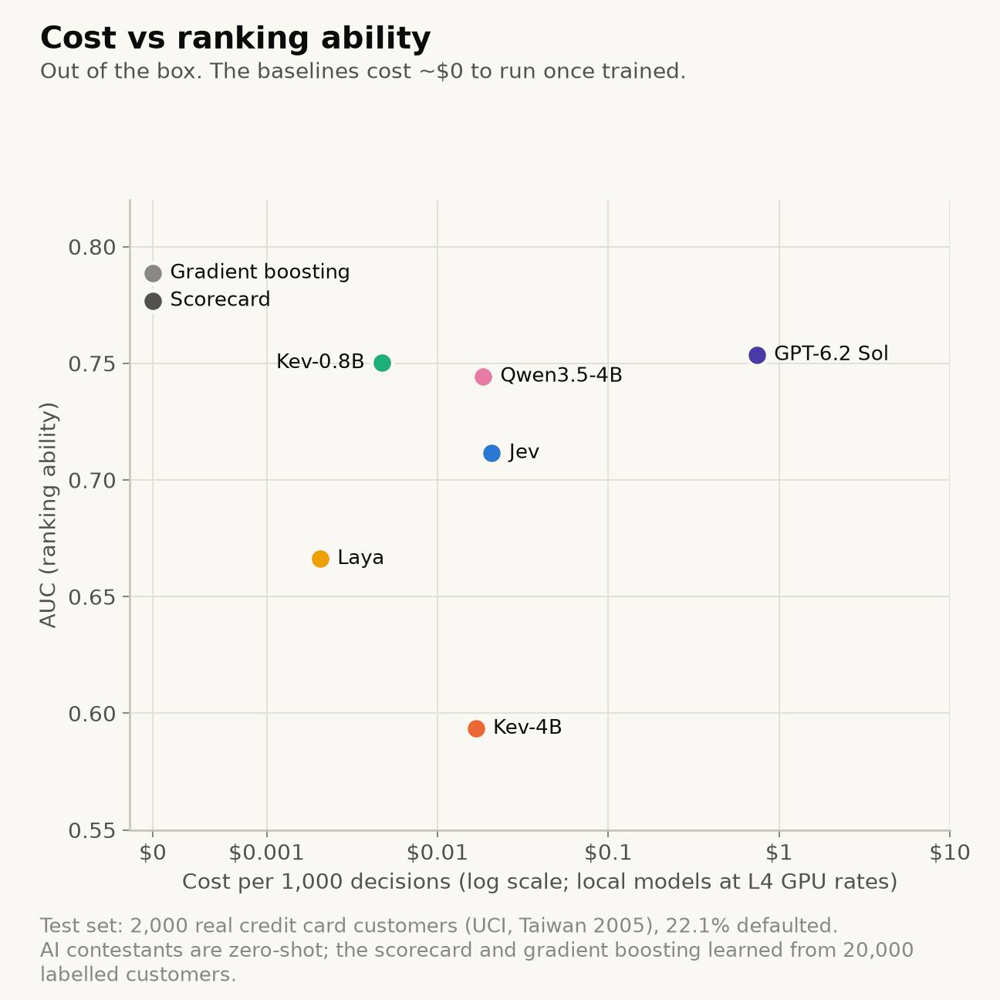

*I checked whether their percentages come true, the way banks are expected to check their own.*

When a weather app says there's a 70% chance of rain, you don't expect rain every time. You expect it on about seven of every ten days it says that. If it rains on all ten, or on two, the app wasn't wrong on any single day. It was wrong about how sure it was.

Banks are held to this standard. Every lending decision rests on a probability that the customer won't pay back, and banks that build their own risk models are [expected to show](https://www.bis.org/basel_framework/chapter/CRE/36.htm) that those probabilities hold up against what actually happens. If a model says 10% and 30% of those customers default, there's a problem, however well it ranked them.

AI models hand out percentages now too. A [new kind of model](https://typesafe.ai/blog/introducing-system-one-models-and-jev), built for yes-or-no decisions, returns a confidence with every answer, and any chatbot will give you a probability if you ask. So when an AI says "30% likely", does it mean 30%? Statisticians call this property [calibration](https://scikit-learn.org/stable/modules/calibration.html). I spent years building credit-risk models, where an honest probability matters more than a clever one, so I ran the calibration part of the checks a bank would run.

## The experiment

I used a [well-known public dataset](https://archive.ics.uci.edu/dataset/350/default+of+credit+card+clients): 30,000 credit-card customers of a bank in Taiwan in 2005, and whether each one missed their next payment. About 22% did. Every model was scored on the same 2,000 test customers, and nothing was ever adjusted using them.

Each model saw the credit limit and six months of bills, payments and repayment status. Nothing else: I left out age, sex, marital status and education on purpose. The AI models got it as a short summary like this, followed by one question, *will this customer miss next month's payment?*

```
Credit card account summary
Credit limit: NT$160,000

Month (most recent first) | Bill amount | Amount paid | Repayment status
Sep 2005 | NT$30,265 | NT$131 | paid on time (code -1)
Aug 2005 | -NT$131 (credit) | NT$396 | paid on time (code -1)
Jul 2005 | -NT$527 (credit) | NT$396 | not late (code -2)
...
```

Eight contestants answered, covering the main ways a business can get a probability out of AI today:

| Contestant | What it is |
|---|---|
| **[Jev](https://typesafe.ai/blog/introducing-system-one-models-and-jev)** (TypeSafe) | A commercial "decision model": ask it a yes-or-no question and it answers with a confidence |
| **[Kev-4B, Kev-0.8B](https://github.com/jaredpalmer/kev)** | Open-source decision models, free to run on your own hardware |
| **[Laya](https://huggingface.co/convaiinnovations/laya)** | A tiny open decision model. Its makers call it "a fast base to specialise, not a zero-shot decision engine", so this tests it beyond its brief |
| **[Qwen3.5-4B](https://huggingface.co/Qwen/Qwen3.5-4B)** | A small general-purpose model. I read its probability from how much weight it put on "yes" versus "no" ([token log-probabilities](https://cookbook.openai.com/examples/using_logprobs)) |
| **[GPT-6.2 Sol](https://openrouter.ai/openai/gpt-6.2-sol)** | OpenAI's frontier chat model, asked for a probability from 0 to 100 |
| **[Scorecard](https://en.wikipedia.org/wiki/Credit_scorecards)** | A [logistic regression](https://en.wikipedia.org/wiki/Logistic_regression), the kind of model banks have used for decades |
| **[Gradient boosting](https://en.wikipedia.org/wiki/Gradient_boosting)** | The standard modern machine-learning model |

The six AI models answered cold, with no examples ([zero-shot](https://en.wikipedia.org/wiki/Zero-shot_learning)). The scorecard and gradient boosting learned from 20,000 other customers whose outcomes were known. That isn't an even contest, and I'll say so wherever I compare them. But it is the practical question: do you need the new AI, or the old model and some data?

Each AI model answered three ways:

1. **Out of the box.**
2. **With one extra sentence** stating the [base rate](https://en.wikipedia.org/wiki/Base_rate): "In this portfolio, about 22.1% of customers miss next month's payment." That's exactly the test customers' rate, so it's the best case.
3. **After [recalibration](https://scikit-learn.org/stable/modules/calibration.html):** like fixing a bathroom scale that always reads 3 kg heavy. The correction was learned from 2,000 other customers with known outcomes, then applied unchanged to the test customers.

## What "honest" looks like

Here's the whole test in one picture, a [reliability diagram](https://scikit-learn.org/stable/modules/calibration.html#calibration-curves). For each model, I sorted the customers by predicted risk, split them into ten equal groups, and plotted what the model promised for each group against what actually happened.

{: data-dark-src="/public/images/can-ai-know-when-its-wrong/1_promised_vs_actual-dark.png"}

On the diagonal, a model is honest: when it says 30%, 30% default. Below it, the model is too pessimistic. Take the top-right dot in Jev's panel, the 200 customers Jev rated riskiest: it promised that about 80% of them would default, and 63% did. The grey line is the scorecard, and it hugs the diagonal.

I'll sum up the gap as one number, the *expected calibration error* ([ECE](https://arxiv.org/abs/1706.04599)): the average distance between promised and actual. The scorecard's is 0.014, so its percentages are off by about 1.4 points. Even a perfectly honest model would be 1 to 3 points off by chance on 2,000 customers, so smaller gaps are noise.

## What I found

### 1. Most AI models think customers are riskier than they are

Five of the six overstated the risk. Jev said 48% of these customers would default, on average, and Kev-4B said 49%. The real figure was 22%. A bank acting on Jev's numbers would put 70% of its customers in the "40% or more" risk band, where only 26% actually defaulted.

**What a bank would see.** Customers grouped by the risk each model predicted, out of the box. Each cell shows the default rate the model promised → the rate that actually happened, and the share of customers in that band. Starred models were trained on 20,000 labelled customers.

| Model | 0–10% | 10–20% | 20–40% | 40% or more |
|---|:---:|:---:|:---:|:---:|
| Scorecard\* | 8% → 6%<br><small>22% of customers</small> | 14% → 14%<br><small>49% of customers</small> | 28% → 31%<br><small>15% of customers</small> | 64% → 64%<br><small>14% of customers</small> |
| Gradient boosting\* | 7% → 6%<br><small>28% of customers</small> | 14% → 14%<br><small>39% of customers</small> | 28% → 30%<br><small>18% of customers</small> | 62% → 63%<br><small>15% of customers</small> |
| Jev | 8% → 19%<br><small>1% of customers</small> | 15% → 16%<br><small>7% of customers</small> | 30% → 13%<br><small>23% of customers</small> | 58% → 26%<br><small>70% of customers</small> |
| Kev-4B | 9% → 22%<br><small>&lt;1% of customers</small> | 16% → 14%<br><small>1% of customers</small> | 32% → 16%<br><small>25% of customers</small> | 55% → 24%<br><small>74% of customers</small> |
| Kev-0.8B | none | 19% → 11%<br><small>22% of customers</small> | 25% → 14%<br><small>53% of customers</small> | 53% → 50%<br><small>25% of customers</small> |
| Laya | 7% → 11%<br><small>18% of customers</small> | 15% → 17%<br><small>50% of customers</small> | 27% → 34%<br><small>21% of customers</small> | 57% → 40%<br><small>11% of customers</small> |
| Qwen3.5-4B | 9% → 12%<br><small>&lt;1% of customers</small> | 16% → 14%<br><small>5% of customers</small> | 29% → 13%<br><small>68% of customers</small> | 56% → 47%<br><small>26% of customers</small> |
| GPT-6.2 Sol | 8% → 12%<br><small>14% of customers</small> | 14% → 10%<br><small>47% of customers</small> | 27% → 24%<br><small>21% of customers</small> | 72% → 61%<br><small>17% of customers</small> |

Jev's error is mostly a constant shift: it ranks customers sensibly, but every number starts too high. Part of Kev-4B's error was my fault, as I explain below. Only Laya and GPT-6.2 Sol were near the truth out of the box, both about 5 points off.

### 2. Telling them the base rate helps, but unpredictably

The one extra sentence took Kev-4B from 27 points off to 3, Jev from 26 to about 15, and Sol from 5 to 3. It improved Qwen's numbers but made it worse at ranking customers, made no clear difference to Laya, and broke Kev-0.8B, whose error tripled from 9 points to 27.

There's a more reliable way to use the same fact: shift each model's numbers by one fixed amount until they average 22%. That needs no customer outcomes and can't change how a model ranks. It beat the sentence for four of the six models, leaving Kev-4B 2 points off and Jev 7.

{: data-dark-src="/public/images/can-ai-know-when-its-wrong/2_honesty_arc-dark.png"}

### 3. The closest model knew this dataset

GPT-6.2 Sol looked like the star, so I checked whether it had seen this data before.

- **It could recite 31 customers** from the original data file, word for word, in standard [memorization tests](https://arxiv.org/abs/2404.06209).
- **It knows the dataset.** Shown one of my summaries and asked which public dataset it came from, it named this one every time and gave its exact default rate, 22.12%, even with the dates, currency and codes removed. (My question did invite a dataset name.)
- **It listens.** Told a false rate of 10%, it lowered its average from 26% to 18%.

It doesn't seem to know the file's patterns: it ranks the "not late" customers in the opposite order to what happened here. But it knows this dataset and how often its customers defaulted, so its score isn't a clean zero-shot result. On a bank's own customers, there's no famous dataset to remember.

### 4. The trained models still rank customers best

Honest percentages are half the job. The other half is putting risky customers above safe ones, measured by a score called [AUC](https://en.wikipedia.org/wiki/Receiver_operating_characteristic#Area_under_the_curve), where 0.5 is a coin flip and 1.0 is perfect. Gradient boosting scored 0.789 and the scorecard 0.777, both trained on 20,000 labelled customers. The best AI models, Kev-4B with the base rate (0.757) and Sol (0.754), were 2 to 3.5 points behind, which matches [earlier work on this same dataset](https://arxiv.org/abs/2608.30086).

In lending terms, that gap is small. Approving the 80% of customers each model rated safest, 13.6% of the scorecard's approvals would default, against 13.4% of Sol's.

{: data-dark-src="/public/images/can-ai-know-when-its-wrong/3_ranking_auc_ks-dark.png"}

### 5. You can buy honesty back, with labels

Recalibrating on 2,000 customers with known outcomes brought every AI model to within 2 to 4 points, close to the scorecard. The catch: labelled outcomes are exactly what zero-shot AI was supposed to free you from needing. And with those same 2,000 labels, a scorecard trained from scratch ranks as well as the best AI model (AUC 0.758).

### 6. It's cheap either way

Sol cost about 74 cents per 1,000 decisions, Jev about 2 cents, and the open models under 2 cents on one rented GPU. The whole experiment, every check included, cost about 14 dollars in API calls plus a few more for GPU time.

{: data-dark-src="/public/images/can-ai-know-when-its-wrong/5_cost_vs_auc-dark.png"}

## Why the results look like this

I broke the test customers down by their most recent repayment status:

| Most recent status | Customers | Actually defaulted | Jev | Kev-4B | Laya | GPT-6.2 Sol | Scorecard |
|---|---:|---:|---:|---:|---:|---:|---:|
| Not late (code −2) | 177 | 15% | 24% | 33% | 19% | 10% | 12% |
| Paid on time (code −1) | 405 | 14% | 30% | 37% | 12% | 13% | 15% |
| Not late (code 0) | 971 | 12% | 51% | 54% | 20% | 18% | 13% |
| 1 month late | 245 | 37% | 61% | 51% | 27% | 51% | 36% |
| 2 months late | 170 | 72% | 75% | 58% | 34% | 74% | 66% |
| 3+ months late | 32 | 75% | 81% | 63% | 30% | 87% | 79% |

- **One group causes most of the overstatement.** Half the customers carry a balance and pay part of it on time ("not late, code 0"). They're about as safe as people who pay in full: only 12% defaulted. Jev predicted 51% for them and Kev-4B 54%, which accounts for about three quarters of both models' overstatement. To a lender, paying part of a balance on time is ordinary; it's how card issuers earn interest. The models seem to read a small payment against a large bill as a customer in trouble.
- **Some models start near even odds.** Decision models learn from tasks where "yes" isn't rare, so with no base rate they seem to start close to 50/50. That's what the base-rate sentence corrects.
- **It isn't the era.** The models could see these were Taiwanese customers in 2005, but card default rates elsewhere are a fraction of 22%. And hiding the dates and currency pushed most models' numbers up, not down. That reads as sensitivity to wording, not knowledge of a crisis.
- **My table's layout hurt one model.** Each row put a month's payment beside that month's bill, but payments usually settle the previous month's bill. With each bill shown beside the payment that settles it, Kev-4B's average fell from 49% to 36% and its ranking rose from 0.59 to 0.72. Laya did worse, and the others barely changed. I noted this as a data quirk before the runs, but not as a possible tilt, which it was.
- **Honest on average isn't the same as useful.** Laya's average is close to right, but its numbers barely follow lateness: it gives customers two months late 34%, when 72% of them defaulted.
- **The scorecard learned what the AI models had to guess.** From 20,000 labelled examples, it learned what this data's repayment codes really mean, starting with the most important lesson: partial payers who pay on time are safe.

## I got most of my own predictions wrong

Before running anything, I wrote down my guesses and committed them to the repository, so I couldn't quietly revise them later.

| My guess | What happened |
|---|---|
| Jev would be the most honest | ✗ Out of the box, its percentages ran about 26 points high |
| Laya would be the least honest | ✗ Laya was among the closest on average |
| Telling the base rate would help most models | ✓ Mostly: it helped four (Qwen's numbers at a cost to its ranking), made no clear difference to one, and broke one |
| At least one AI model would beat the scorecard at ranking | ✗ None did |

One out of four. The 20-customer trial run I did before guessing had already shown Jev averaging 55% and Laya 23%. I went with reputation over a small sample, and the small sample was right.

## What I'd tell a bank

- **Ask "when it says 30%, how often is it right?", not just "how accurate is it?"** A model can rank customers well and still give you numbers that are double the truth.
- **Use your own default rate, on the output.** Shifting a model's numbers until they average your rate needs no labels and can't hurt its ranking. Putting the rate in the prompt helped most models but broke one.
- **Hold back a labelled sample and recalibrate.** Here, 2,000 customers was enough, though with 2,000 labels you could also train a scorecard that ranks as well.
- **Test on data the model can't have seen.** Famous public datasets flatter large language models, which can know a great deal about them.
- **Test how you show the data.** One change to my table's layout halved Kev-4B's calibration error and lifted its ranking from 0.59 to 0.72, while it made Laya worse.
- **For ranking alone, a trained model is hard to beat.** The case for AI here isn't better risk ranking, at least not yet.

## What this test can't tell you

- **Honest isn't self-aware:** "knowing when it's wrong" here means percentages you can trust, which tell *you* when to doubt a model. That's not the model being aware of its own mistakes. A model can be well calibrated with no insight into its reasoning, and still argue hard for a wrong answer.
- **One dataset:** one bank, one country, 2005, and a portfolio where 22% defaulted. Honesty depends on that rate: where 5% default, every model here would overstate, the scorecard included.
- **A famous dataset:** AI models have seen it in training. I tested the ones I could, but the decision models can't be checked this way.
- **Not like for like:** the AI models answered cold, while the trained models learned from customers of the same bank and the same months. Banks validate on a later period, because patterns drift.
- **One template:** every AI model got the same wording, and wording matters. Changing it moved results by up to 13 points.
- **Models change:** these are the versions I tested in November 2026, all recorded.

## The deep dive, and what's next

Everything behind these results is in [the deep dive](https://github.com/nishzsche/can-ai-know-when-its-wrong/blob/main/writeup/deep_dive.md): the statistics behind each claim, every check I ran to see whether the results could be fooling me, the tables model by model, related research and how to reproduce it all. The code and every prediction are on [GitHub](https://github.com/nishzsche/can-ai-know-when-its-wrong).

Percentages that don't come true are one way a model can mislead you. A single headline number is another, so next I'll look at why 99% accuracy can still be a disaster. After that comes the sequel to this post: training my own small decision model and rewarding it for knowing when it doesn't know.
