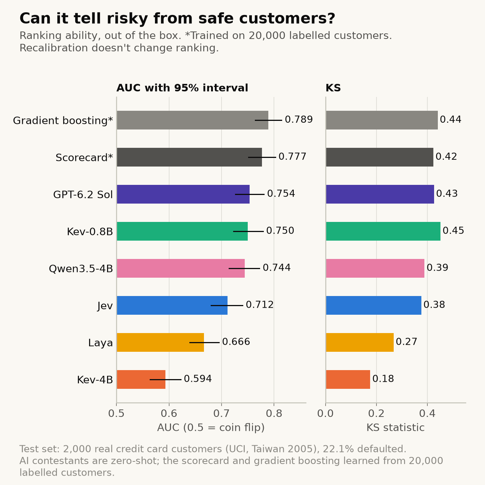
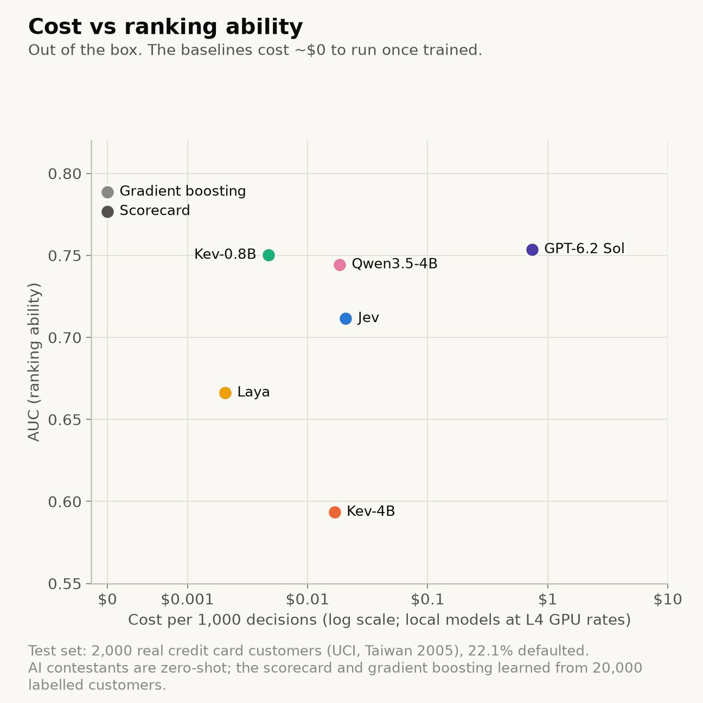

> **Draft for review, version 3 (23 November), not yet published.** Thank you for reading. Since the last version, a review panel checked every claim against the data, so several findings are worded more carefully, and there are two new checks: hiding the dates and currency, and a different table layout, which turned out to matter for one model.
>
> **To comment, no account needed:** reply to my message and quote the sentence you mean. If you already use [Hypothesis](https://web.hypothes.is/), you can also select text and click **Annotate**.
>
> I'd most like to know: where did you get lost or bored, does finding 3 still land, and does anything feel overstated?

*I gave eight models the same 2,000 real credit-card customers and checked whether their percentages meant what they said.*

When a weather app says there's a 70% chance of rain, you don't expect rain every time. You expect it on about seven of every ten days the app says that. If it rains on all ten, or on two, the app wasn't wrong on any single day. It was wrong about how sure it was.

Banks are held to exactly this standard. Every lending decision rests on a number: the probability that this customer won't pay back. Banks that build their own risk models are [expected to show](https://www.bis.org/basel_framework/chapter/CRE/36.htm) that those probabilities hold up against what actually happens. If a model says 10% and 30% of those customers default, there's a problem, however well it ranked them.

AI models hand out percentages now too. A [new kind of model](https://typesafe.ai/blog/introducing-system-one-models-and-jev), built only for yes-or-no decisions, returns an answer with a confidence attached, and any chatbot will give you a probability if you ask. So I wanted to know: when an AI says "30% likely", does it mean 30%? Statisticians call this property [calibration](https://scikit-learn.org/stable/modules/calibration.html).

I spent years building credit-risk models, where an honest probability matters more than a clever one. So I ran the calibration part of the checks a bank would run.

## The experiment

I used a [well-known public dataset](https://archive.ics.uci.edu/dataset/350/default+of+credit+card+clients): 30,000 credit-card customers of a bank in Taiwan in 2005, and whether each one missed their next payment. About 22% did. I split the customers into four groups:

- **Test (2,000):** every model is scored on these same customers, and no model or setting was ever adjusted using them.
- **Train (20,000):** for teaching the two classic models.
- **Tune (2,000):** customers with known outcomes, used only to correct the AI models' percentages ("recalibration", below).
- **Reserve (6,000):** never used.

Each contestant saw the same information about each customer: the credit limit and six months of bills, payments and repayment status. Nothing else. I left out age, sex, marital status and education on purpose. A lending model shouldn't use them, and leaving them out keeps the comparison clean. For the AI models, that became a short text summary:

```
Credit card account summary
Credit limit: NT$160,000

Month (most recent first) | Bill amount | Amount paid | Repayment status
Sep 2005 | NT$30,265 | NT$131 | paid on time (code -1)
Aug 2005 | -NT$131 (credit) | NT$396 | paid on time (code -1)
Jul 2005 | -NT$527 (credit) | NT$396 | not late (code -2)
...
```

followed by one question: *will this customer miss next month's payment?*

Eight contestants answered. Together they cover the main ways a business can get a probability out of AI today: buy a model built for decisions, run an open one yourself, read one out of a general-purpose model, or simply ask a chatbot. Two classic models set the bar.

| Contestant | What it is | Why it's here |
|---|---|---|
| **[Jev](https://typesafe.ai/blog/introducing-system-one-models-and-jev)** (TypeSafe) | A commercial "decision model": ask it a yes-or-no question and it answers with a confidence | The newest kind of AI built for yes-or-no decisions, with a confidence on every answer |
| **[Kev-4B, Kev-0.8B](https://github.com/jaredpalmer/kev)** | Open-source decision models, in a larger and a smaller size, free to run on your own hardware | What a bank could run in-house, where customer data can't leave the building |
| **[Laya](https://huggingface.co/convaiinnovations/laya)** | A much smaller open decision model | Can a tiny, fast model be honest? Its makers call it "a fast base to specialise, not a zero-shot decision engine", so this tests it beyond its brief |
| **[Qwen3.5-4B](https://huggingface.co/Qwen/Qwen3.5-4B)** | A small, free, general-purpose language model. I read its probability straight from its internals: how much weight it put on "yes" versus "no" ([token log-probabilities](https://cookbook.openai.com/examples/using_logprobs)) | The do-it-yourself route, with any open model |
| **[GPT-6.2 Sol](https://openrouter.ai/openai/gpt-6.2-sol)** | OpenAI's frontier chat model, called through its API and asked for a probability from 0 to 100 | What most people would actually do: ask a chatbot |
| **[Scorecard](https://en.wikipedia.org/wiki/Credit_scorecards)** | A [logistic regression](https://en.wikipedia.org/wiki/Logistic_regression), trained on the 20,000 train customers | The kind of model banks have used for decades |
| **[Gradient boosting](https://en.wikipedia.org/wiki/Gradient_boosting)** | The standard modern machine-learning model, trained on the same 20,000 | The modern bar |

The six AI models answered cold, with no examples ([zero-shot](https://en.wikipedia.org/wiki/Zero-shot_learning)).

That difference matters, and I'll repeat it wherever I compare them: the classic models learned from 20,000 labelled examples, and the AI models got none. But that *is* the practical question. Do you need the new AI, or the old model and some data?

Each AI model answered three ways:
1. **Out of the box.**
2. **With one extra sentence** stating the [base rate](https://en.wikipedia.org/wiki/Base_rate): "In this portfolio, about 22.1% of customers miss next month's payment." That's exactly the test customers' rate, so it's the best case. A bank's own estimate would be rougher.
3. **After [recalibration](https://scikit-learn.org/stable/modules/calibration.html):** like fixing a bathroom scale that always reads 3 kg heavy. You work out the correction on people whose weight you know, then apply it to everyone else. Here the correction was learned from the 2,000 tune customers and applied, unchanged, to the test customers.

## What "honest" looks like

Here's the whole test in one picture, a [reliability diagram](https://scikit-learn.org/stable/modules/calibration.html#calibration-curves). For each model, I sorted the customers from lowest predicted risk to highest and split them into ten equal groups. Then I plotted what the model promised for each group against what actually happened.


How to read it:
- **Each dot is a tenth of the customers.** Take the top-right dot in Jev's panel: the 200 customers Jev rated riskiest. Jev promised that about 80% of them would default; 63% did.
- **On the diagonal, the model is honest.** When it says 30%, 30% default.
- **Below the diagonal, it's too pessimistic.** It promised more defaults than happened, as with that Jev dot. Above the diagonal, it's too optimistic.
- **A flat line means it can't tell customers apart.** Kev-4B's promises range from 24% to 67%, but what actually happened only ranges from 14% to 30%.
- **The grey line is the scorecard,** and it hugs the diagonal.

I'll sum up the gap as one number: the average distance between promised and actual, known as *expected calibration error* ([ECE](https://arxiv.org/abs/1706.04599)). The scorecard's is 0.014, so its percentages are off by about 1.4 points on average.

Some error is unavoidable on 2,000 customers. Even a model whose percentages were exactly right would typically score 1 to 2 points by chance, and up to about 3. So gaps smaller than about 2 points are noise.

## What I found

### 1. Most AI models think customers are riskier than they are

Five of the six overstated the risk, and two of them more than doubled it:
- **Jev** said 48% of these customers would default, on average, and **Kev-4B** said 49%. The real figure was 22%.
- **Part of Kev-4B's error is mine.** My table pairs each payment with the wrong month's bill (explained below). Shown each bill beside the payment that settles it, Kev-4B averaged 36% and ranked customers much better (AUC 0.72).
- **What a bank would see:** acting on Jev's numbers, it would find 70% of its customers in the "40% or more" risk band. In that group, 26% actually defaulted.
- **Mostly a constant shift:** Jev's error is close to a uniform upward shift. Its [calibration slope](https://doi.org/10.1186/s12916-019-1466-7) is 0.97, where 1 is ideal: it ranks customers sensibly, but every number starts too high.
- **The two close ones:** only Laya and GPT-6.2 Sol were near the truth out of the box, both about 5 points off.


### 2. One sentence helps, but unpredictably

Telling the models the portfolio's default rate:
- **Clearly helped three.** Kev-4B went from 27 points off to 3. It also got much better at telling risky customers from safe ones (AUC 0.594 to 0.757), which I didn't expect: the sentence changed *which* customers it flagged. Kev-4B turns out to be unusually sensitive to how the table is laid out, as the layout check below shows. Jev went from 26 points off to about 15, and Sol from 5 to 3.
- **Helped Qwen's numbers but hurt its ranking:** from 14 points off to 7, but its AUC fell from 0.744 to 0.710.
- **Made no clear difference to Laya:** 5 points to 4, within the noise.
- **Broke Kev-0.8B:** its error tripled, from 9 points to 27.

There's a more reliable way to use the same fact. Shift each model's numbers by one fixed amount (on the [log-odds scale](https://en.wikipedia.org/wiki/Logit)) until they average 22.1%. That needs no outcome for any customer, only the overall rate, and it can't change how a model ranks. It beat the sentence for four of the six models: Jev ends 7 points off, Kev-4B 2, Kev-0.8B under 5 and Qwen 6. For Laya and Sol it made no real difference.

Context helps, but only if you check that it does.


### 3. The closest model knew this dataset

GPT-6.2 Sol looked like the star: about 5 points off out of the box and 3 with the base rate. So I checked whether it had seen this data before.

- **It could recite 31 customers from the original data file, word for word**, in standard [memorization tests](https://arxiv.org/abs/2404.06209). Only 3 of them are in my test set, and leaving them out changes nothing.
- **It knows the dataset and its default rate.** Shown one of my summaries and asked which public dataset it came from, it named this one every time, 53 out of 53, and gave its exact default rate: 22.12%. With the currency, the dates and the raw codes removed, it still did, 50 times out of 50. Two limits: my question invited a dataset name, and I didn't show it summaries from anywhere else to see whether it would name this dataset for those too.
- **It listens to what it's told.** Told a false rate, "about 10%", it lowered its average from 26% to 18%. That's 69% of the change in the stated rate, or about half the distance to 10%. Told the true rate, it barely moved.
- **But it doesn't seem to know the file's patterns.** It rates the three "not late" codes in the opposite order to what happened in this data: 10%, 13% and 18%, against 15%, 14% and 12% actual. That fits general credit sense, not a memory of these customers.

So Sol knows this dataset and how often its customers defaulted, and that may be why its average landed so close. I can't show that it used this knowledge rather than making a sensible guess for any card portfolio. Either way, its score here isn't a clean zero-shot result. On a bank's own customers, there's no famous dataset to remember.

### 4. The trained models still rank customers best

Honest percentages are half the job. The other half is putting risky customers above safe ones, measured by a score called [AUC](https://en.wikipedia.org/wiki/Receiver_operating_characteristic#Area_under_the_curve), where 0.5 is a coin flip and 1.0 is perfect.
- **The trained models:** gradient boosting scored 0.789, and the scorecard 0.777.
- **The AI models:** every one ranked below the scorecard. The best two, Kev-4B with the base rate (0.757) and Sol (0.754), were 2 points behind. Compared on the same customers ([paired bootstrap](https://en.wikipedia.org/wiki/Bootstrapping_%28statistics%29)), each of those gaps is real on its own. But I made twelve such comparisons, and after allowing for that (a [Holm correction](https://en.wikipedia.org/wiki/Holm%E2%80%93Bonferroni_method)), the closest six could still be chance (p ≈ 0.06).
- **In lending terms, the best are close.** Suppose a bank approved the 80% of customers each model rated safest. Of the scorecard's approvals, 13.6% would default. For Sol it's 13.4%, and for Kev-0.8B and Jev with the base rate, 13.6%.



### 5. You can buy honesty back, with labels

Recalibration on the 2,000 tune customers brought every AI model to within about 2 to 4 points, depending on how you group the customers. The scorecard scores 1.4 to 2.3 the same ways, and gaps under about 2 points are noise here. (Kev-4B's headline 0.3 is luck of the grouping: with equal-sized groups it's 2.3.) A stricter check by decile, the [Hosmer–Lemeshow test](https://en.wikipedia.org/wiki/Hosmer%E2%80%93Lemeshow_test), still finds Jev, Laya and Qwen off after recalibration. Sol and both Kev models pass it, as do the trained models. Recalibration doesn't change how well a model ranks, only what its numbers mean.

The catch: labelled outcomes are exactly what zero-shot AI was supposed to free you from needing. And with those same 2,000 labels, a scorecard trained from scratch ranks as well as the best AI model (AUC 0.758) and is off by 2.4 points.

### 6. What it costs

- **Sol:** about 74 cents per 1,000 decisions, at around two seconds each.
- **Jev, through its API:** about 2 cents per 1,000.
- **The open models, on one rented GPU:** under 2 cents per 1,000, with answers in milliseconds.
- **The scorecard:** essentially free to run.
- **The whole experiment,** every check included, cost about 14 dollars in API calls plus a few more for GPU time.



## I got most of my own predictions wrong

Before running anything, I wrote down my guesses and committed them to the repository, so I couldn't quietly revise them later.

| My guess | What happened |
|---|---|
| Jev would be the most honest | ✗ Out of the box, its percentages ran about 26 points high |
| Laya would be the least honest | ✗ Laya was among the closest on average |
| Telling the base rate would help most models | ✓ Mostly: it clearly helped four, made no clear difference to one, and broke one |
| At least one AI model would beat the scorecard at ranking | ✗ None did |

One out of four. Which is rather the point: confident guesses need checking.

Looking back, the evidence was in front of me. The 20-customer test run I did before guessing had Jev averaging 55% and Laya 23%, on customers who defaulted 20% of the time. I went with reputation over a small sample, and the small sample was right. The next section explains what was going on: Jev started from the wrong assumption, Laya's average was right but its answers don't follow lateness, and the scorecard had learned something about this data that no AI model knew.

## Why the results look like this

I broke the test customers down by their most recent repayment status and compared what actually happened with what each model predicted.

| Most recent status | Customers | Actually defaulted | Jev | Kev-4B | Laya | GPT-6.2 Sol | Scorecard |
|---|---:|---:|---:|---:|---:|---:|---:|
| Paid on time (code −1) | 405 | 14% | 30% | 37% | 12% | 13% | 15% |
| Not late (code 0) | 971 | 12% | 51% | 54% | 20% | 18% | 13% |
| 1 month late | 245 | 37% | 61% | 51% | 27% | 51% | 36% |
| 2 months late | 170 | 72% | 75% | 58% | 34% | 74% | 66% |

- **One group causes most of the overstatement.** Half the customers are "not late (code 0)": they carry a balance and pay part of it, on time. They're about as safe as the customers who pay in full: only 12% defaulted. Jev predicted 51% for them and Kev-4B 54%, which accounts for about three quarters of both models' overstatement. To a lender, paying part of a balance on time is ordinary; it's how card issuers earn interest. The models seem to read a small payment against a large bill as a customer in trouble.
- **My table's layout hurt one model and suited three.** Each row of the summary puts a month's bill beside the payment made that same month, but a payment usually settles the *previous* month's bill. That could make a payment look small against a bill it isn't paying. So I re-asked every AI model with each bill shown beside the payment made the following month. For Jev, Kev-0.8B and Qwen, their averages moved by less than half a point, and they ranked customers a little worse realigned (Qwen's AUC fell from 0.744 to 0.715). But Kev-4B's average fell from 49% to 36%, its calibration error from 27 points to 14, and its ranking jumped from 0.59 to 0.72. For code 0 customers it went from 54% to 36%. So a good part of Kev-4B's overstatement came from my layout, not its judgement. Laya went the other way: its average rose 6 points and its ranking fell from 0.67 to 0.57. (Sol's realigned run is slowed by its provider's rate limits and still going; I'll add it.)
- **Some models start near even odds.** Kev-4B gives 80% of customers between 30% and 64%, centred near 49%, and Jev averages 48%. My best explanation is that decision models learn from tasks where "yes" isn't rare, so with no base rate they start close to 50/50. [Kev's published training data](https://github.com/jaredpalmer/kev) fits this: general text-classification sets, and nothing like this data. Jev's training data isn't published. This is exactly what the base-rate sentence corrects.
- **It isn't the world's default experience.** Every summary shows 2005 dates and Taiwan dollars, so the models could tell when and where these customers were. But card default rates elsewhere are a fraction of 22%. In the US, [credit-card delinquency](https://fred.stlouisfed.org/series/DRCCLACBS) peaked at 6.8% in the 2009 financial crisis, fell below 2% during COVID as stimulus and payment holidays kicked in, and is about 2.9% now. (That's a different measure, the share of balances 30 or more days late, so it's only a rough guide.) A model leaning on recent world events like COVID, wars or inflation would have *understated* the risk here, not doubled it. Even a model that knew about Taiwan's card-debt crisis should land near this data's 22%, not 48%.
- **Hiding the time and place doesn't bring the numbers down.** I removed the dates, the currency and the raw codes and asked every AI model again. If knowing "Taiwan, 2005" had pushed the numbers up, they should have come down. Four went up instead: Jev by 4 points, Qwen by 3, Kev-4B by 1.5 and Sol by 1. Laya fell 5 points and Kev-0.8B 1. Run-to-run noise was under half a point. That reads as sensitivity to wording, not knowledge of the era.
- **Honest on average isn't the same as useful.** Laya's percentages are close to right on average, and they do vary from customer to customer, but not much with lateness. It gives customers two months late 34%, when 72% of them defaulted, and code 0 customers 20%. Calibration and ranking are separate skills, and Laya has more of the first. (Its makers built it as a base to fine-tune, not to use cold.)
- **Sol tracks reality for late payers:** 51% for one month late (37% actual) and 74% for two months late (72% actual). But it gets the three "not late" groups in the wrong order (finding 3), which fits general credit sense rather than a memory of this file.
- **Small models can misread context.** Told that "about 22% of customers miss a payment", Kev-0.8B raised its average from 31% to 49%. It seems to treat the sentence as a warning sign, not a statistic.
- **The ceiling is low.** Even gradient boosting, trained on 20,000 customers, reaches only 0.789. Six months of payment history can only tell you so much. The best AI models' 0.75 is about 88% of the way from a coin flip to the best trained model.
- **The scorecard learned what the AI models had to guess.** From 20,000 labelled examples, it learned what this data's repayment codes really mean, starting with the most important lesson: customers paying part of their balance on time are about as safe as those who pay in full.

## What would change with different data

**The portfolio's default rate changes who looks honest, mostly through the average.** These customers defaulted at 22%. I reweighted the same customers to imitate portfolios where 5% or 50% default: the same kinds of defaulters and non-defaulters, in different proportions. Then I measured calibration error again, in points off:

| If the default rate were | 5% | 22% (actual) | 50% |
|---|---:|---:|---:|
| Jev | 41 | 26 | 11 |
| Kev-4B | 43 | 27 | 5 |
| Kev-0.8B | 23 | 9 | 15 |
| Laya | 14 | 5 | 28 |
| Qwen3.5-4B | 28 | 14 | 10 |
| GPT-6.2 Sol | 17 | 5 | 17 |
| Scorecard (trained at 22%) | 13 | 1.4 | 22 |

- **Most of this is arithmetic.** At 5%, a model's error is roughly how far its average prediction sits above 5%, so the models with high averages look worst. The reweighting also assumes defaulters and non-defaulters look the same in a safer portfolio, which real portfolios needn't follow.
- **In a low-risk book, everyone overstates,** and the models that start near even odds overstate most.
- **In a high-risk book, the order flips.** At 50%, Kev-4B becomes the most honest model and Laya the least.
- **The scorecard is no exception.** It's honest at 22% because that's the rate it was trained on.
- **Ranking ability doesn't move.** AUC compares defaulters with non-defaulters, so the mix doesn't affect it. Honesty does.

So "is this model honest?" only has an answer for a particular portfolio. You need at least your own default rate to find it, and ideally some labelled outcomes. Other things that would likely change the picture:
- **Data the models haven't seen.** On a bank's own customers, Sol can't recognise the portfolio, and I'd expect its out-of-the-box honesty to fall back towards the others'. I haven't tested this.
- **A different era.** These customers were observed in 2005, in the run-up to Taiwan's credit-card debt crisis, which [the dataset's authors](https://doi.org/10.1016/j.eswa.2007.12.020) say peaked in 2006. That's why so many of them defaulted. A normal year means a lower default rate: see the table. The trained models would feel this too, since they were tested on the same months they learned from.
- **Richer data.** Income, credit-bureau scores or a longer history would raise the ceiling for the trained models. Whether they help the AI models depends on whether a longer summary stays easy to read.
- **Different wording.** I used one fixed template for every AI model, and wording matters. Removing the currency, dates and raw codes moved the models' averages by 1 to 5 points, in both directions. Moving each payment next to the bill it pays cut Kev-4B's average by 13 points, raised Laya's by 6, and left Jev's average alone while changing its answers by about 8 points per customer, on average. Other wordings could shift these numbers too, so test yours before trusting any one result.

## What others have found

I'm not the first to put AI models in front of credit data, and two of my results match earlier work:
- **Trained models rank customers better.**
  - [Datta and Prahallad (2026)](https://arxiv.org/abs/2608.30086) used this same dataset, with a 2,000-customer test set too. A trained random forest ranked customers better than an LLM shown a dozen examples (AUC 0.790 vs 0.719).
  - [AlMarri et al. (2025)](https://arxiv.org/abs/2510.25701) found the same on LendingClub loans: LightGBM beat three small open LLMs.
- **LLM probabilities are unreliable.** [Kostrzewa et al. (2025)](https://arxiv.org/abs/2511.16375) asked Llama-3.3 to predict company bankruptcies. Gradient boosting won, and the LLM's probabilities bunched at a few round values such as 0.1, 0.2, 0.7 and 0.9.
- **LLMs memorize famous datasets.** [Bordt et al. (2024)](https://arxiv.org/abs/2404.06209) showed that they score better on the datasets they've memorized. When the model knows facts about a dataset rather than its rows, as Sol knows this default rate, researchers call it [semantic contamination](https://www.arxiv.org/pdf/2510.20351).
- **Decision models have been calibration-tested before,** but on general classification tasks such as BANKING77, not credit risk ([Towards AI](https://pub.towardsai.net/a-decision-model-as-a-gate-fast-well-calibrated-and-still-wrong-16-of-the-time-2ddb226b1ed5), [Towards Data Science](https://towardsdatascience.com/scikit-learn-matched-or-beat-jevs-calibration-on-banking77), [Amplitude](https://amplitude.com/blog/jev-analysis)).

**What this post adds.** The credit studies measure ranking or accuracy, not whether the percentages come true. None of them tells the model the base rate, and none checks whether the model has seen the data. This post applies the standard banks are held to (promised vs actual, calibration error, recalibration), tests a true and a false base rate, and checks for memorization and recognition. That's how it finds that the closest model knew this dataset's default rate.

## What I'd tell a bank

- **Ask "when it says 30%, how often is it right?", not just "how accurate is it?"** A model can rank customers well and still give you numbers that are double the truth.
- **Don't take a zero-shot percentage at face value.** Hold back a labelled sample from your own portfolio and recalibrate. Here, 2,000 customers was enough, though with 2,000 labels you could also train a scorecard that ranks as well. Honesty depends on your default rate, so a test on someone else's data won't tell you.
- **Use your base rate, on the output.** Shifting a model's numbers until they average your default rate needs no labels, can't hurt its ranking, and beat putting the rate in the prompt for four of six models. Putting it in the prompt helped most models but broke one.
- **Test on data the model can't have seen.** Famous public datasets flatter large language models, which can know a great deal about them.
- **For ranking alone, a trained model is hard to beat.** The case for AI here isn't better risk ranking, at least not yet.

## What this test can't tell you

- **One dataset:** one bank, one country, 2005. The section above shows how much the default rate alone could change.
- **A famous dataset:** AI models have seen it in training. I tested the ones I could, but the decision models can't be probed this way.
- **No demographic fields, on purpose:** every contestant lost them equally.
- **Partly undocumented repayment codes:** so I showed the AI models the raw codes rather than guess their meaning.
- **One layout choice tilted the comparison, both ways.** Each row puts a month's payment beside that month's bill, though payments usually settle the previous month's bill. The trained models learn the real relationship from data; an AI model reading the table might not. I noted this as a data quirk before the runs but didn't flag it as a possible tilt, which it is. Re-asked with the payments realigned, Kev-4B did much better (average 49% to 36%, calibration error 27 points to 14, AUC 0.59 to 0.72), Laya did worse (AUC 0.67 to 0.57), and Jev, Qwen and Kev-0.8B did slightly worse. The headline numbers use the layout I fixed before the runs; the realigned results are reported next to them.
- **The base-rate sentence was the best case:** it stated exactly this portfolio's rate.
- **Not like for like:** the AI models answered cold while the classic models were trained. That's the real-world trade-off, but it isn't an even contest.
- **The trained models were tested at home.** The scorecard and gradient boosting learned from customers of the same bank, in the same six months, as the test customers (a random split). Banks validate on a later period, because patterns drift. In another year or at another bank, the trained models would lose some honesty too and need retraining. The AI models had only general knowledge, which misses local quirks like this data's repayment codes.
- **Models change:** these results are for the versions I tested in November 2026, all recorded.

## What's next

Percentages that don't come true are one way a model can mislead you. A single headline number is another, so next I'll look at why 99% accuracy can still be a disaster. After that comes the sequel to this post: training my own small decision model and rewarding it for knowing when it doesn't know.

---

## Appendix: method and how to reproduce

Code, every prediction and every check: [github.com/nishzsche/can-ai-know-when-its-wrong](https://github.com/nishzsche/can-ai-know-when-its-wrong).

**Data**
- **Source:** [UCI "Default of Credit Card Clients"](https://archive.ics.uci.edu/dataset/350/default+of+credit+card+clients): Yeh, I. C., & Lien, C. H. (2009), *Expert Systems with Applications* 36(2), 2473–2480, [doi:10.1016/j.eswa.2007.12.020](https://doi.org/10.1016/j.eswa.2007.12.020). Licence: CC BY 4.0.
- **Splits:** 30,000 customers, split with a fixed seed and stratified on the outcome: train 20,000, tune 2,000, test 2,000, and a reserve of 6,000 that is never used. The default rate is 22.1% in each.
- **Inputs:** 19 fields (credit limit, and six months each of bill amount, amount paid and repayment status). Sex, marital status, age and education are dropped before any rendering or training.

**The question**
- **One template, unit-tested and versioned (v2),** renders every customer for every AI model. Repayment codes are shown raw, with only their documented meaning, because the common interpretation of the undocumented codes is contradicted by the data.
- **The base-rate condition** puts one sentence in front of the question. Recalibration picks [Platt scaling](https://en.wikipedia.org/wiki/Platt_scaling) or [isotonic regression](https://en.wikipedia.org/wiki/Isotonic_regression) per model by 5-fold [cross-validation](https://en.wikipedia.org/wiki/Cross-validation_%28statistics%29) on tune, then applies it to test. Nothing is ever tuned on test.

**Contestants and versions**

| Contestant | Version and setup |
|---|---|
| Jev | `typesafe/jev-1.14-20261014` via [OpenRouter](https://openrouter.ai)'s System One endpoint |
| Kev-4B, Kev-0.8B | [`jaredpalmer/kev`](https://github.com/jaredpalmer/kev) v1.0, served on an NVIDIA L4 |
| Laya | `convaiinnovations/laya` at revision `fd4f9dbc`, on the L4 |
| Qwen3.5-4B | `Qwen/Qwen3.5-4B` at `851bf6e8`, served by [vLLM](https://github.com/vllm-project/vllm) with thinking off. P(yes) comes from the first answer token's top-20 [logprobs](https://cookbook.openai.com/examples/using_logprobs), with every spelling of each option combined |
| GPT-6.2 Sol | `openai/gpt-6.2-sol` via OpenRouter: reasoning effort medium (it used no reasoning tokens on 90% of answers), seed 0, strict JSON answer |
| Scorecard | [Weight-of-evidence binning](https://en.wikipedia.org/wiki/Credit_scorecards) plus logistic regression, all 19 fields |
| Gradient boosting | [LightGBM](https://github.com/microsoft/LightGBM), 157 rounds; isotonic-calibrated on tune |

**Metrics**
- **Ranking:** [AUC](https://en.wikipedia.org/wiki/Receiver_operating_characteristic#Area_under_the_curve) and [KS](https://en.wikipedia.org/wiki/Kolmogorov%E2%80%93Smirnov_test).
- **Calibration:** calibration error ([ECE](https://arxiv.org/abs/1706.04599), 10 equal-width bins), [Brier score](https://en.wikipedia.org/wiki/Brier_score), and [calibration-in-the-large and calibration slope](https://doi.org/10.1186/s12916-019-1466-7).
- **Intervals:** [bootstrap](https://en.wikipedia.org/wiki/Bootstrapping_%28statistics%29) 95% intervals (1,000 resamples) for AUC, ECE and calibration-in-the-large.
- **Robustness (`analysis/robustness.py`):** ECE with 10 equal-mass bins as well as equal-width; the ECE a perfectly calibrated model would score with the same predictions (simulated, median and 95th percentile); a [Hosmer–Lemeshow test](https://en.wikipedia.org/wiki/Hosmer%E2%80%93Lemeshow_test) by decile; paired bootstrap AUC differences against the scorecard (2,000 resamples) with a [Holm correction](https://en.wikipedia.org/wiki/Holm%E2%80%93Bonferroni_method) over twelve comparisons; the default rate among the 80% each model rates safest; a label-free shift of each model's log-odds so its average equals the train default rate; and the scorecard refit on the 2,000 tune customers alone.
- **Records:** every prediction is saved with its probability, model version, latency and cost.

**Checks on my own results**
- **Memorization tests** ([tabmemcheck](https://github.com/interpretml/LLM-Tabular-Memorization-Checker), from [Bordt et al., 2024](https://arxiv.org/abs/2404.06209), plus a longer, deterministic version with room for the model's reasoning): GPT-6.2 Sol reproduces 31 customers verbatim, 3 of them in test. Without those 3, no metric for any model moves by more than 0.0006. Qwen3.5-4B showed no memorization. The decision models can't be probed this way.
- **Recognition:** asked which public dataset a summary came from, Sol names this one for 53 of 53 summaries and states its default rate (22.12%). With the currency, dates and raw codes removed, it still does, 50 of 50. The question invites a dataset name, and there's no negative control (summaries from another source).
- **Disguise:** each AI model re-answered the 2,000 test customers with no currency symbol, months numbered instead of dated, and raw codes replaced by neutral labels, plus 200 customers on the original summaries to measure run-to-run noise (at most 0.3 points). Change in average prediction: Jev +4.1 points, Qwen +3.4, Kev-4B +1.5, Sol +0.8, Kev-0.8B −1.3, Laya −4.8. Ranking got a little worse for most, much worse for Laya (AUC 0.666 to 0.625), and better for Kev-4B (0.594 to 0.651). Details in `data/contamination.md`.
- **Layout:** each bill re-shown beside the payment made the following month, out of the box, on the 2,000 tune customers and then the 2,000 test customers. On test: Kev-4B's average −13.1 points (ECE 0.267 to 0.135, AUC 0.594 to 0.720), Laya +6.0 (ECE 0.052 to 0.060, AUC 0.666 to 0.569), Jev +0.2 (AUC 0.712 to 0.692), Qwen −0.3 (AUC 0.744 to 0.715), Kev-0.8B −0.2 (AUC 0.750 to 0.743). Tune agrees closely. Sol: in progress.
- **False base rate:** on 500 test customers told "about 10.0%", Sol's average fell from 0.258 to 0.175, a pass-through of 0.69 (95% interval 0.64–0.73), with its ranking unchanged.
- **Qwen option order:** swapping which letter means "yes" left its average probability almost unchanged (−0.004), and the two orders' answers correlated at 0.91, so there's no letter bias.
- **A bug in a library:** jevper, an open-source adapter used to prompt Qwen, mis-read its probabilities when the model spelled an option more than one way. I computed them myself instead and [reported the bug upstream](https://github.com/zhulinchng/jevper/issues/1).

**Reproduce**

```bash
uv run python data/load.py && uv run python data/splits.py
uv run python data/render.py --split test
uv run python baselines/scorecard.py && uv run python baselines/gbm.py
uv run --group runners python runners/<contestant>.py --split test   # needs API keys / a GPU
uv run python analysis/recalibrate.py
uv run python analysis/summarize.py && uv run python analysis/figures.py
uv run python analysis/robustness.py
```
