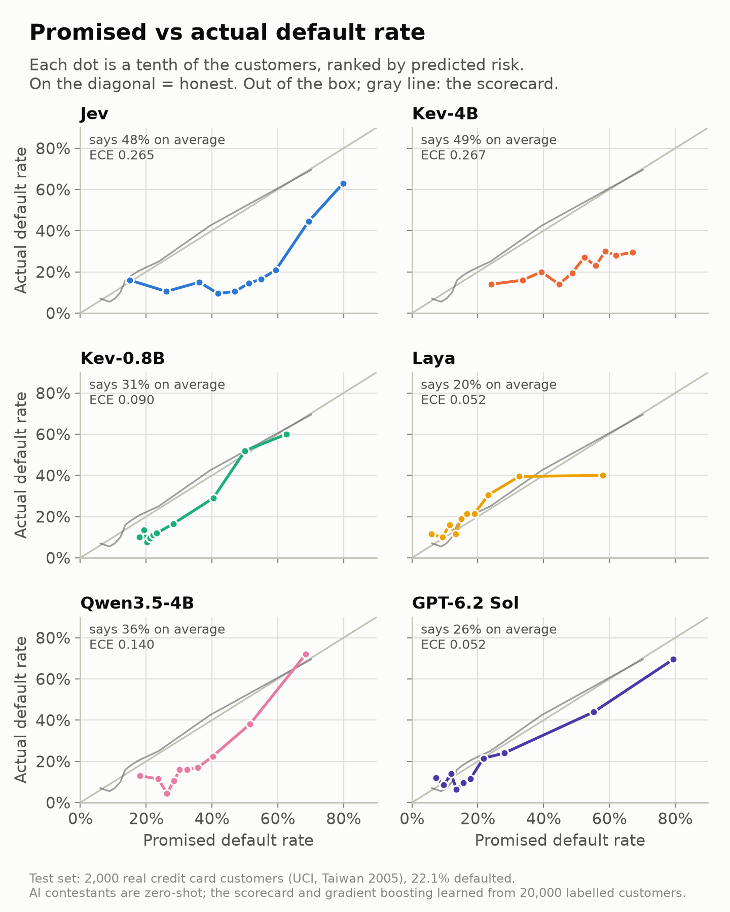
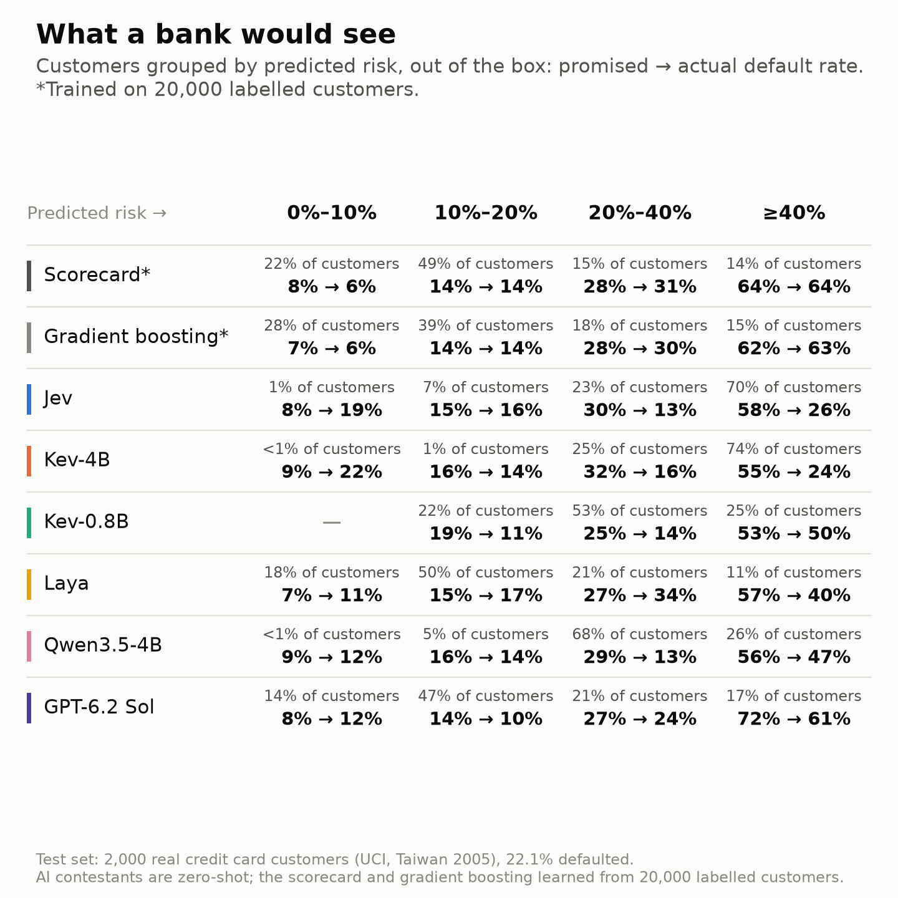
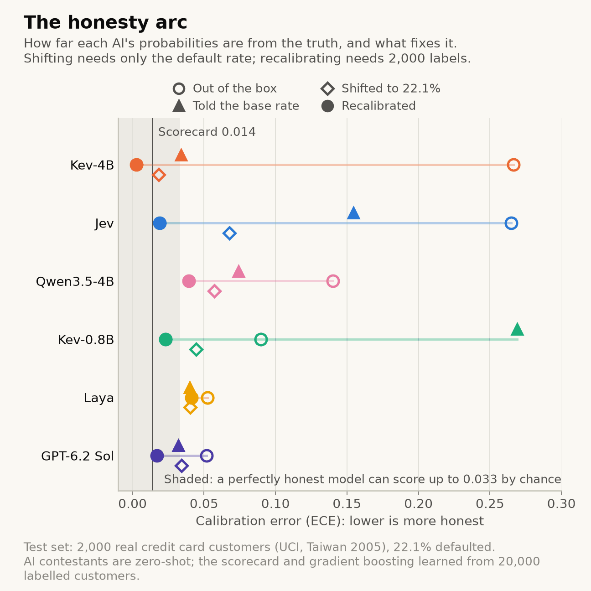

> **Draft for review, not yet published.** Thank you for reading. To comment, select any text and click **Annotate**, or open the sidebar with the arrow at the top right. Commenting needs a free [Hypothesis](https://web.hypothes.is/) account. I'd most like to know: where did you get lost or bored, does the twist in finding 3 land, and does anything feel overstated?

*I gave eight models the same 2,000 real credit-card customers and checked whether their percentages meant what they said.*

When a weather app says there's a 70% chance of rain, you don't expect rain every time. You expect it on about seven of every ten days the app says that. If it rains on all ten, or on two, the app wasn't wrong on any single day. It was wrong about how sure it was.

Banks are held to exactly this standard. Every lending decision rests on a number: the probability that this customer won't pay back. Banks that build their own risk models are expected to show that those probabilities hold up against what actually happens. If a model says 10% and 30% of those customers default, there's a problem, however well it ranked them.

AI models hand out percentages now too. A new kind of model, built only for yes-or-no decisions, returns an answer with a confidence attached, and any chatbot will give you a probability if you ask. So I wanted to know: when an AI says "30% likely", does it mean 30%?

I spent years building credit-risk models, where an honest probability matters more than a clever one. So I ran the test a bank would run.

## The experiment

I used a well-known public dataset: 30,000 credit-card customers of a bank in Taiwan in 2005, and whether each one missed their next payment. About 22% did. I set aside 2,000 customers as the test, the same 2,000 for every contestant.

Each contestant saw the same information about each customer: the credit limit and six months of bills, payments and repayment status. Nothing else. I left out age, sex, marital status and education on purpose. A lending model shouldn't use them, and leaving them out keeps the comparison clean. For the AI models, that became a short text summary:

```
Credit card account summary
Credit limit: NT$160,000

Month (most recent first) | Bill amount | Amount paid | Repayment status
Sep 2005 | NT$30,265 | NT$131 | paid on time (code -1)
Aug 2005 | -NT$131 (credit) | NT$396 | paid on time (code -1)
Jul 2005 | -NT$527 (credit) | NT$396 | not late (code -2)
...
```

followed by one question: *will this customer miss next month's payment?*

Eight contestants answered.

**Six AI models, answering cold**, with no examples:
- **Jev**, from TypeSafe: a commercial "decision model", built to answer closed questions with a confidence.
- **Kev-4B, Kev-0.8B and Laya**: open-source decision models, which I ran on a rented GPU.
- **Qwen3.5-4B**: a small, free, general-purpose language model. I read its probability straight from its internals: how much weight it put on "yes" versus "no".
- **GPT-6.2 Sol**: the model ChatGPT starts new chats on, simply asked for a probability from 0 to 100.

**Two classic models**, trained the old way on 20,000 customers whose outcomes were known:
- a **scorecard** (a logistic regression), the kind banks have used for decades;
- **gradient boosting**, the standard modern machine-learning approach.

That difference matters, and I'll repeat it wherever I compare them: the classic models learned from 20,000 labelled examples, and the AI models got none. But that *is* the practical question. Do you need the new AI, or the old model and some data?

Each AI model answered three ways:
1. **Out of the box.**
2. **With one extra sentence:** "In this portfolio, about 22.1% of customers miss next month's payment."
3. **After recalibration:** 2,000 *other* customers with known outcomes were used to correct its percentages.

## What "honest" looks like

Here's the whole test in one picture. For each model, I sorted the customers from lowest predicted risk to highest and split them into ten equal groups. Then I plotted what the model promised for each group against what actually happened.



On the diagonal, the model is honest: when it says 30%, 30% default. The grey line is the scorecard, and it hugs the diagonal. I'll sum up the gap as one number: the average distance between promised and actual, known as *calibration error* (ECE). The scorecard's is 0.014, so its percentages are off by about 1.4 points on average.

## What I found

### 1. Most AI models think customers are riskier than they are

Five of the six overstated the risk, and two of them more than doubled it:
- **Jev** said 48% of these customers would default, on average, and **Kev-4B** said 49%. The real figure was 22%.
- **What a bank would see:** acting on Jev's numbers, it would find 70% of its customers in the "40% or more" risk band. In that group, 26% actually defaulted.
- **The two close ones:** only Laya and GPT-6.2 Sol were near the truth out of the box, both about 5 points off.



### 2. One sentence fixes most of it

Telling the models the portfolio's default rate improved calibration for five of the six:
- **Kev-4B** went from 27 points off to 3. It also got much better at telling risky customers from safe ones, which I didn't expect: the sentence changed *which* customers it flagged.
- **Kev-0.8B** went the wrong way: its error tripled, from 9 points to 27.

Context helps, but only if you check that it does.



### 3. The most "honest" model had seen the answers

GPT-6.2 Sol looked like the star: about 5 points off out of the box and 3 with the base rate. So I checked whether it had seen this data before. It had.

- **It could recite 31 customers from the original data file, word for word.** Only 3 of them are in my test set, and leaving them out changes nothing.
- **It recognises the dataset.** Shown any one of my summaries and asked where it came from, it named the dataset every time, 53 out of 53, and gave its exact default rate: 22.12%.
- **Hiding the obvious clues didn't help.** I removed the currency, the dates and the raw codes, and it still recognised the dataset 50 times out of 50, from the shape of the data alone.
- **Then I told it a false rate,** "about 10%", and it moved about 70% of the way there. So it does listen to what it's told. When told the true rate, it barely moved, because it already knew.

Sol's percentages are honest here most likely because it knows this population, not because it judged each customer well from scratch. On a bank's own customers, there's no famous dataset to remember. (In fairness to Sol, I can't fully rule out that it would guess about 25% for any credit-card portfolio.)

### 4. The old scorecard still ranks customers best

Honest percentages are half the job. The other half is putting risky customers above safe ones, measured by a score called AUC, where 0.5 is a coin flip and 1.0 is perfect.
- **The classic models:** the scorecard scored 0.777, and gradient boosting 0.789.
- **The AI models:** none beat the scorecard, though the best came within the margin of error. Kev-4B with the base rate scored 0.757, and Sol 0.754.


### 5. You can buy honesty back, with labels

Recalibration with 2,000 labelled customers brought every AI model's error down to between 0.3 and 4 points, close to the scorecard's 1.4. It doesn't change how well a model ranks, only what its numbers mean.

The catch: labelled outcomes are exactly what zero-shot AI was supposed to free you from needing. And with 20,000 of them, a scorecard ranks better than any of the AI models.

### 6. What it costs

- **Sol:** about 74 cents per 1,000 decisions, at around two seconds each.
- **Jev, through its API:** about 2 cents per 1,000.
- **The open models, on one rented GPU:** under 2 cents per 1,000, with answers in milliseconds.
- **The scorecard:** essentially free to run.
- **The whole experiment,** every check included, cost about 14 dollars in API calls plus a few more for GPU time.


## I got most of my own predictions wrong

Before running anything, I wrote down my guesses and committed them to the repository, so I couldn't quietly revise them later.

| My guess | What happened |
|---|---|
| Jev would be the most honest | ✗ Jev was among the least honest out of the box |
| Laya would be the least honest | ✗ Laya was among the most honest |
| Telling the base rate would help most models | ✓ It helped five of six |
| At least one AI model would beat the scorecard at ranking | ✗ None did |

One out of four. Which is rather the point: confident guesses need checking.

## What I'd tell a bank

- **Ask "when it says 30%, how often is it right?", not just "how accurate is it?"** A model can rank customers well and still give you numbers that are double the truth.
- **Don't take a zero-shot percentage at face value.** Hold back a labelled sample and recalibrate. Here, 2,000 customers was enough.
- **Tell the model your base rate.** It's free, and it helped five of six models. But test it, because it broke one.
- **Test on data the model can't have seen.** Famous public datasets flatter large language models, which can be remarkably good at recognising them.
- **For ranking alone, the old scorecard is hard to beat.** The case for AI here isn't better risk ranking, at least not yet.

## What this test can't tell you

- **One dataset:** one bank, one country, 2005.
- **A famous dataset:** AI models have seen it in training. I tested the ones I could, but the decision models can't be probed this way.
- **No demographic fields, on purpose:** every contestant lost them equally.
- **Partly undocumented repayment codes:** so I showed the AI models the raw codes rather than guess their meaning.
- **Not like for like:** the AI models answered cold while the classic models were trained. That's the real-world trade-off, but it isn't an even contest.
- **Models change:** these results are for the versions I tested in November 2026, all recorded.

## What's next

Dishonest percentages are one way a model can mislead you. A single headline number is another, so next I'll look at why 99% accuracy can still be a disaster. After that comes the sequel to this post: training my own small decision model and rewarding it for knowing when it doesn't know.

---

## Appendix: method and how to reproduce

Code, every prediction and every check: [github.com/nishzsche/can-ai-know-when-its-wrong](https://github.com/nishzsche/can-ai-know-when-its-wrong).

**Data**
- **Source:** UCI "Default of Credit Card Clients": Yeh, I. C., & Lien, C. H. (2009), *Expert Systems with Applications* 36(2), 2473–2480, doi:10.1016/j.eswa.2007.12.020. Licence: CC BY 4.0.
- **Splits:** 30,000 customers, split with a fixed seed and stratified on the outcome: train 20,000, tune 2,000, test 2,000, and a reserve of 6,000 that is never used. The default rate is 22.1% in each.
- **Inputs:** 19 fields (credit limit, and six months each of bill amount, amount paid and repayment status). Sex, marital status, age and education are dropped before any rendering or training.

**The question**
- **One template, unit-tested and versioned (v2),** renders every customer for every AI model. Repayment codes are shown raw, with only their documented meaning, because the common interpretation of the undocumented codes is contradicted by the data.
- **The base-rate condition** puts one sentence in front of the question. Recalibration picks Platt scaling or isotonic regression per model by 5-fold cross-validation on tune, then applies it to test. Nothing is ever tuned on test.

**Contestants and versions**

| Contestant | Version and setup |
|---|---|
| Jev | `typesafe/jev-1.14-20261014` via OpenRouter's System One endpoint |
| Kev-4B, Kev-0.8B | `jaredpalmer/kev` v1.0, served on an NVIDIA L4 |
| Laya | `convaiinnovations/laya` at revision `fd4f9dbc`, on the L4 |
| Qwen3.5-4B | `Qwen/Qwen3.5-4B` at `851bf6e8`, served by vLLM with thinking off. P(yes) comes from the first answer token's top-20 logprobs, with every spelling of each option combined |
| GPT-6.2 Sol | `openai/gpt-6.2-sol` via OpenRouter: reasoning effort medium, seed 0, strict JSON answer |
| Scorecard | Weight-of-evidence binning plus logistic regression, all 19 fields |
| Gradient boosting | LightGBM, 157 rounds; isotonic-calibrated on tune |

**Metrics**
- **Ranking:** AUC and KS.
- **Calibration:** calibration error (ECE, 10 equal-width bins), Brier score, calibration-in-the-large, and calibration slope.
- **Intervals:** bootstrap 95% intervals (1,000 resamples) for AUC, ECE and calibration-in-the-large.
- **Records:** every prediction is saved with its probability, model version, latency and cost.

**Checks on my own results**
- **Memorization tests** (tabmemcheck, plus a longer, deterministic version with room for the model's reasoning): GPT-6.2 Sol reproduces 31 customers verbatim, 3 of them in test. Without those 3, no metric for any model moves by more than 0.0006. Qwen3.5-4B showed no memorization. The decision models can't be probed this way.
- **Recognition:** Sol names the dataset for 53 of 53 summaries and states its default rate (22.12%). With the currency, dates and raw codes removed, it still does, 50 of 50.
- **False base rate:** on 500 test customers told "about 10.0%", Sol's average fell from 0.258 to 0.175, a pass-through of 0.69 (95% interval 0.64–0.73), with its ranking unchanged.
- **Qwen option order:** swapping which letter means "yes" left its average probability almost unchanged (−0.004), and the two orders' answers correlated at 0.91, so there's no letter bias.
- **A bug in a library:** jevper, an open-source adapter used to prompt Qwen, mis-read its probabilities when the model spelled an option more than one way. I computed them myself instead and reported the bug upstream.

**Reproduce**

```bash
uv run python data/load.py && uv run python data/splits.py
uv run python data/render.py --split test
uv run python baselines/scorecard.py && uv run python baselines/gbm.py
uv run --group runners python runners/<contestant>.py --split test   # needs API keys / a GPU
uv run python analysis/recalibrate.py
uv run python analysis/summarize.py && uv run python analysis/figures.py
```
